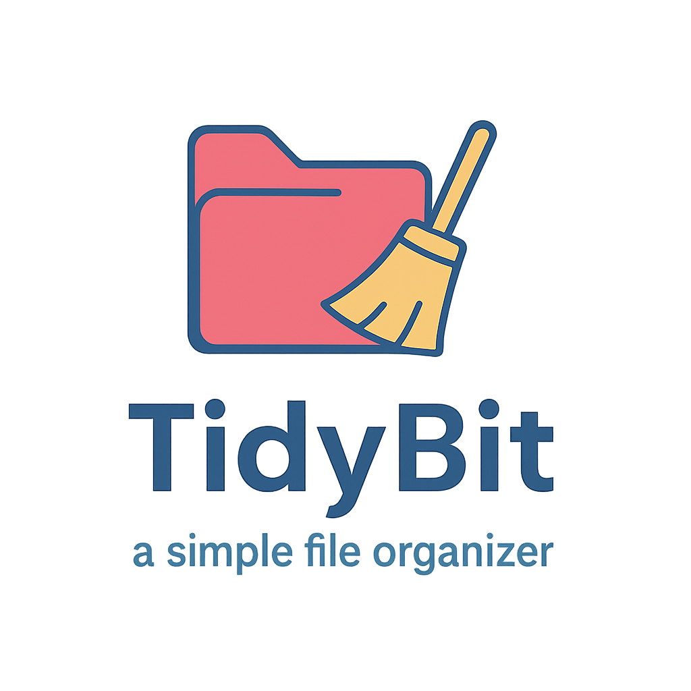
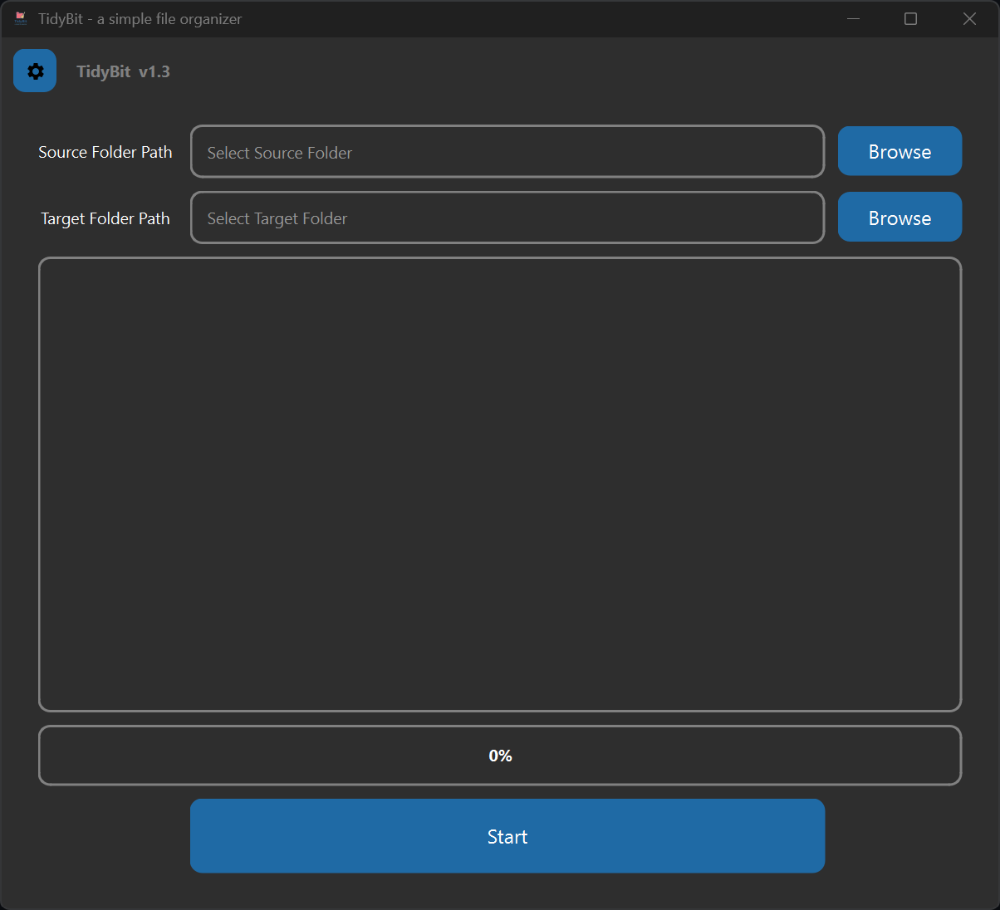
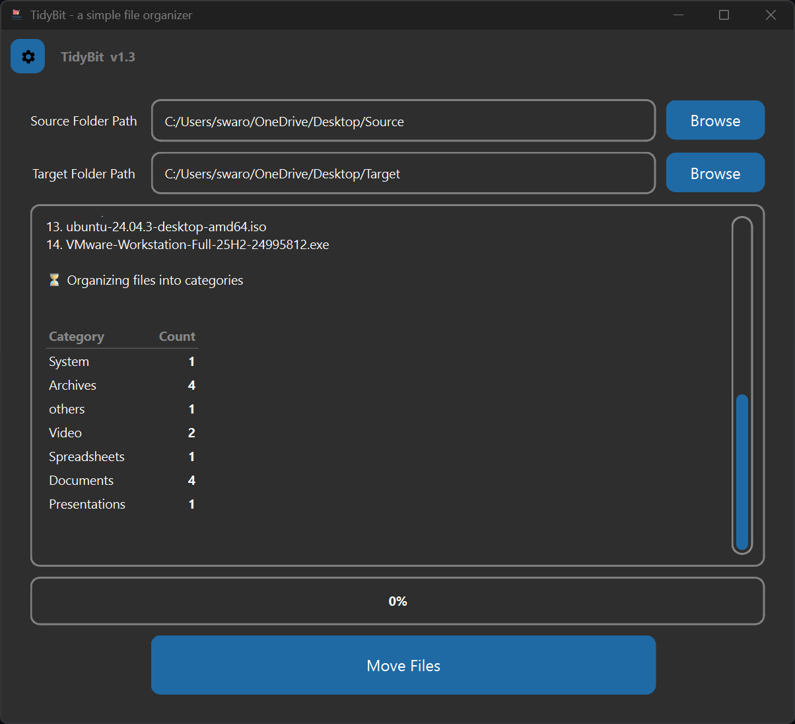
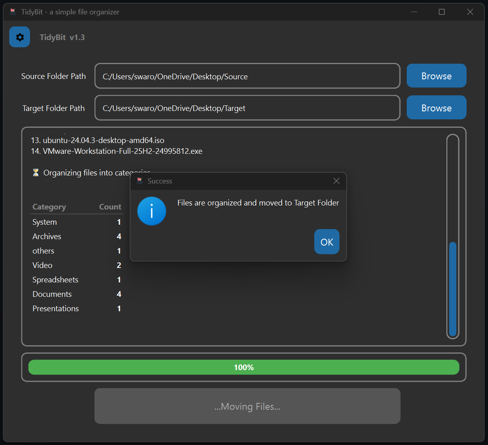
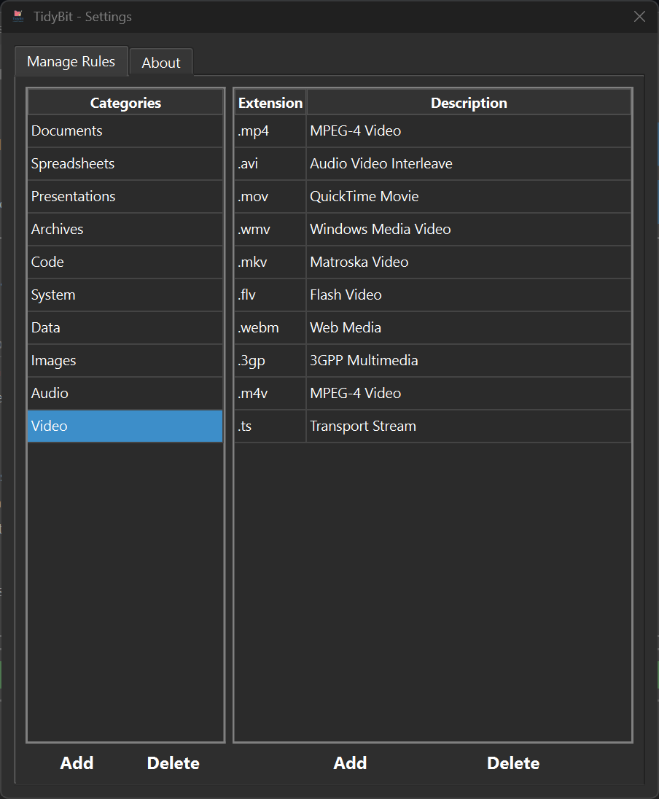
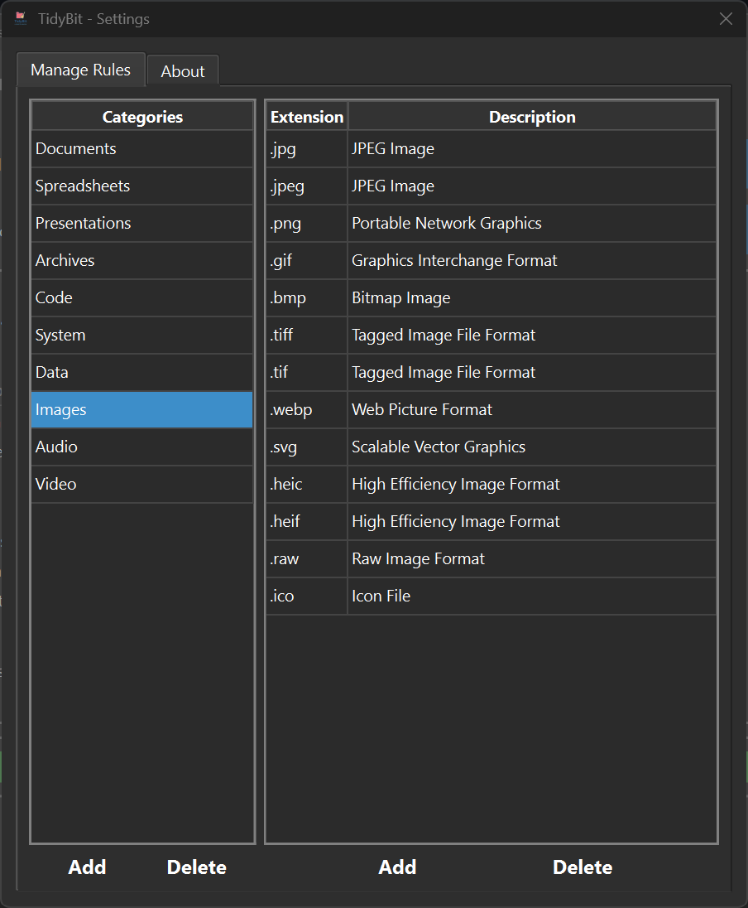
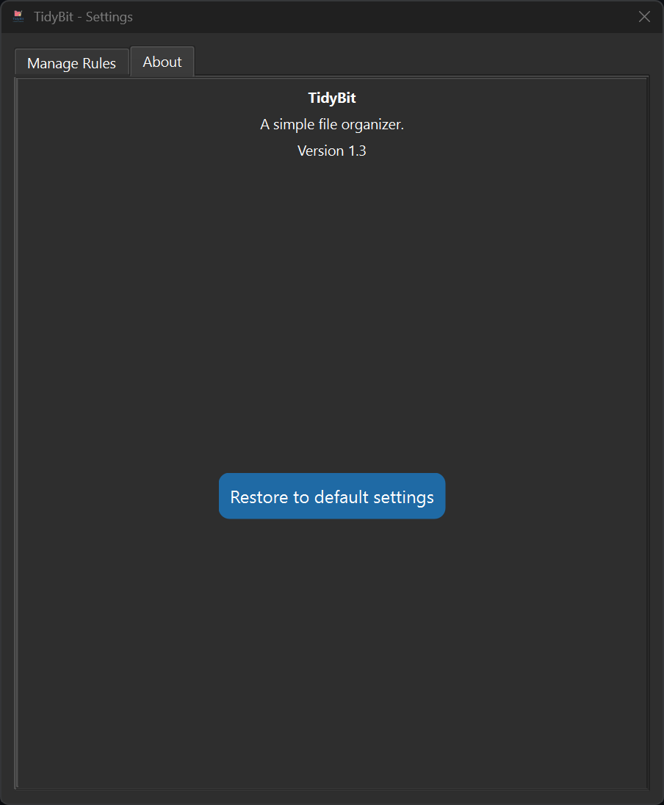

<p align="center">
  
</p>

# TidyBit — Cross-Platform File Organizer

A desktop file organizer app built with **Python and PySide6**, published on the **Microsoft Store** and **Linux Snap Store**. TidyBit helps you clean up cluttered folders by automatically categorizing and moving files based on customizable rules.


[](https://snapcraft.io/tidybit)

---

## Download

### Windows
[](https://apps.microsoft.com/store/detail/9PGJQVC129C0)

- Automatic updates
- Recommended for most users

---

### Linux (Snap)
[](https://snapcraft.io/tidybit)

- Easy installation
- Auto updates via Snap

---

### Direct Download (GitHub Releases)
[](https://github.com/Veda-Swaroop/TidyBit/releases)

**Windows:** Download the `.exe` setup file and run the installer.

**Linux (AppImage):**
1. Download the `.AppImage` file
2. Right-click → Properties → Permissions → Enable "Allow executing file as program"
3. Double-click to run

> **Note:** If the AppImage fails to run on Linux, it may be a FUSE version issue. See [AppImage - FUSE](https://github.com/AppImage/AppImageKit/wiki/FUSE) for instructions.

> Store versions are recommended for automatic updates and better system integration.

---

## Screenshots

<p align="center">
  
  
  
</p>
<p align="center">
  
  
  
</p>

---

## How It Works

TidyBit operates in four clear steps:

1. **Validation** — Confirm source and target folder paths
2. **Fetch Files** — Display all files from the source folder
3. **Organize** — Categorize files based on rules defined in Settings (documents, images, videos, code, archives, etc.)
4. **Move** — Create subfolders in the target directory and move files accordingly

The app works only on files directly inside the source folder. Sub-directories within the source location are ignored.

---

## Features

- Clean, beginner-friendly GUI with step-by-step workflow
- Real-time progress bar during file operations
- Handles large files and files on external drives
- Duplicate file handling
- Pre-defined rules for commonly used file types and categories
- Fully customizable rules — add, modify, or delete
- Option to reset and restore default rules
- Clear error messages and user feedback at each step

---

## Installation (Running from Source)

```bash
git clone https://github.com/Veda-Swaroop/TidyBit.git
cd TidyBit
pip install -r requirements.txt
python run.py
```

---

## Contributing

Contributions, issues, and feature requests are welcome. Feel free to open an issue or submit a pull request.

---

## License

This project is licensed under the [MIT License](LICENSE).